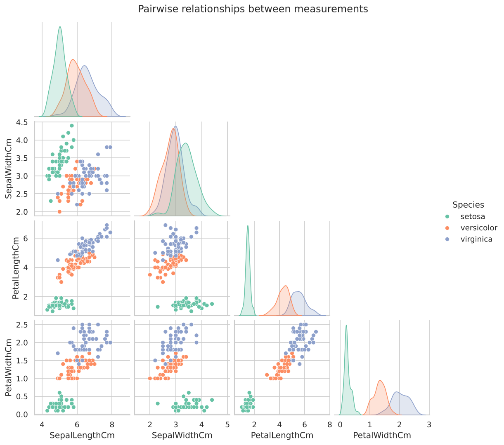
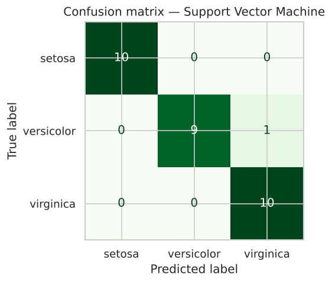
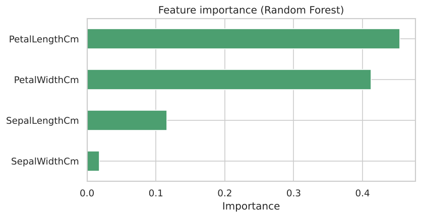

<div align="center">

# 🌸 Iris Flower Classification

**CodeAlpha Data Science Internship · Task 1**

      

A machine learning model that identifies the species of an Iris flower from four simple measurements, with **96.7% accuracy**.

</div>

---

## 📑 Table of Contents
- [Overview](#-overview)
- [Dataset](#-dataset)
- [Project Workflow](#-project-workflow)
- [Results](#-results)
- [Key Insights](#-key-insights)
- [Visualizations](#-visualizations)
- [Project Structure](#-project-structure)
- [Getting Started](#-getting-started)
- [Tech Stack](#-tech-stack)
- [Author](#-author)

## 📌 Overview
The Iris dataset is the classic starting point for machine learning classification. Each flower has
four measurements: **sepal length, sepal width, petal length and petal width**. The goal is to predict
which of the three species it belongs to: *Iris setosa*, *Iris versicolor* or *Iris virginica*.

This project walks through a full classification workflow: exploring the data, comparing several
algorithms, evaluating the best one on unseen data and using it to predict new flowers.

## 📂 Dataset
| Property | Value |
|---|---|
| Source | [Iris dataset on Kaggle](https://www.kaggle.com/datasets/saurabh00007/iriscsv) |
| Rows | 150 flowers (50 per species) |
| Features | `SepalLengthCm`, `SepalWidthCm`, `PetalLengthCm`, `PetalWidthCm` |
| Target | `Species` |
| Missing values | None |

The dataset is included in the [`data/`](data/) folder, so the notebook runs without any extra downloads.

## 🔄 Project Workflow
1. **Data inspection**: shape, data types, missing values, duplicates and class balance
2. **Exploratory data analysis**: pair plot, box plots per species and a correlation heatmap
3. **Preprocessing**: label encoding, a stratified 80/20 train/test split, and feature scaling inside pipelines
4. **Model training**: 5 classifiers compared with 5-fold stratified cross-validation
5. **Evaluation**: accuracy, precision, recall, F1-score and a confusion matrix
6. **Interpretation**: feature importance from a Random Forest
7. **Prediction**: species predicted for new, unseen flower measurements

## 📊 Results
| Model | CV Accuracy | Test Accuracy |
|---|:---:|:---:|
| 🏆 **Support Vector Machine** | **96.7%** | **96.7%** |
| Logistic Regression | 95.8% | 93.3% |
| K-Nearest Neighbors | 95.8% | 93.3% |
| Decision Tree | 95.0% | 93.3% |
| Random Forest | 95.0% | 90.0% |

> Models are compared using **5-fold cross-validation** on the training set. The test set is held out until the end for a fair final check.

## 💡 Key Insights
- 🌿 **Petal length and petal width** are the most important features. They separate the species far better than sepal measurements.
- ✅ *Setosa* is always classified correctly, because it is completely separated from the other two species.
- 🔄 The only mistakes are between *versicolor* and *virginica*, whose measurements overlap slightly.
- 📈 Every model scores above 90%, which shows how well the measurements describe each species.

## 🖼️ Visualizations
### Pairwise relationships between features


### Confusion matrix of the best model


### Feature importance


More charts are available in the [`images/`](images/) folder and in the notebook.

## 🗂️ Project Structure
```
CodeAlpha_IrisFlowerClassification/
├── Iris_Flower_Classification.ipynb      # Full analysis with code, charts and explanations
├── iris_flower_classification.py           # Same analysis as a plain Python script
├── data/                                   # Dataset
├── images/                                 # Saved charts
├── requirements.txt                        # Python dependencies
└── README.md
```

## 🚀 Getting Started

**1. Clone the repository**
```bash
git clone https://github.com/Lohith-L/CodeAlpha_IrisFlowerClassification.git
cd CodeAlpha_IrisFlowerClassification
```

**2. (Optional) Create a virtual environment**
```bash
python -m venv venv
source venv/bin/activate        # Windows: venv\Scripts\activate
```

**3. Install the dependencies**
```bash
pip install -r requirements.txt
```

**4. Open the notebook**
```bash
jupyter notebook Iris_Flower_Classification.ipynb
```
Then choose **Kernel → Restart & Run All**.

Or run the Python script instead:
```bash
python iris_flower_classification.py
```

## 🛠️ Tech Stack
| Tool | Purpose |
|---|---|
| Python | Programming language |
| Pandas, NumPy | Data cleaning and manipulation |
| Matplotlib, Seaborn | Data visualization |
| Scikit-learn | Machine learning models and evaluation |
| Jupyter Notebook | Interactive analysis |

## 👤 Author

**Lohith L**
BCA Student · Data Science Intern at CodeAlpha

- GitHub: [@Lohith-L](https://github.com/Lohith-L)

## 🙏 Acknowledgements

- [CodeAlpha](https://www.codealpha.tech) for the internship opportunity and project guidance
- [Kaggle](https://www.kaggle.com) for the dataset

---
⭐ If you found this project useful, consider giving it a star!
